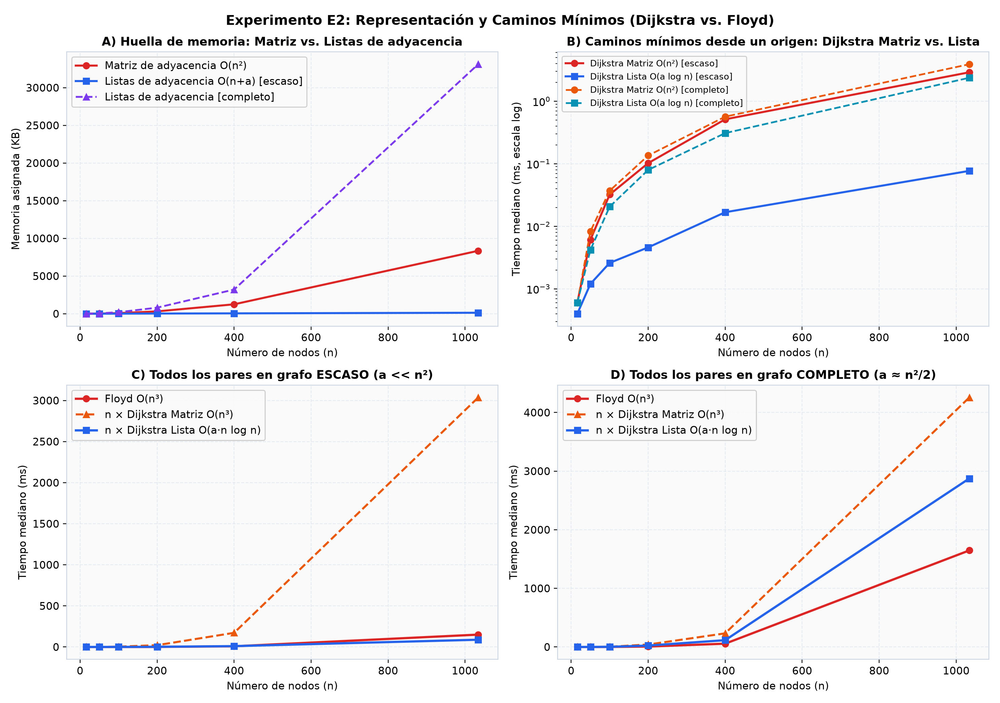
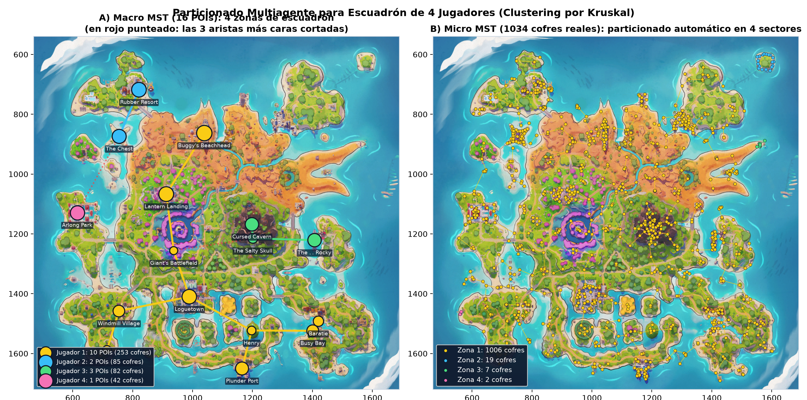
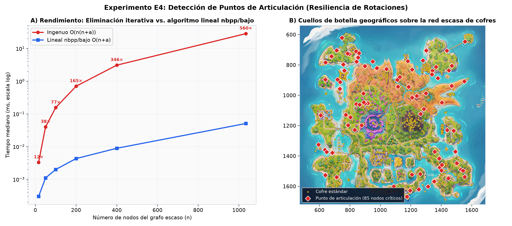
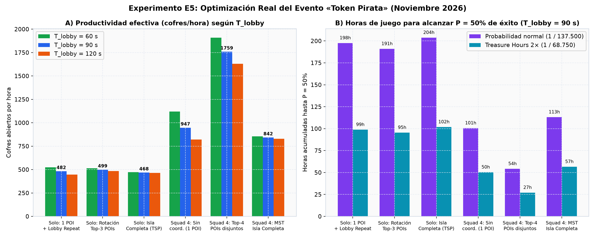

# Optimización de Rutas y Particionado Multiagente sobre Grafos Espaciales

### Estudio Algorítmico Aplicado al Evento «Token Pirata» de Fortnite (2026)


**Asignatura:** Algoritmos y Estructuras de Datos I (AED1) — Grado en Ingeniería Informática (Curso 2026/2027)  
**Centro:** Facultad de Informática, Universidad de Murcia  
**Autores:** [Nombre y Apellidos Alumno 1] · [Nombre y Apellidos Alumno 2]  
**Memoria PDF:** [docs/memoria_aed1_t4.pdf](docs/memoria_aed1_t4.pdf)

---

## Índice

1. [Descripción y objetivo](#descripcion)
2. [Datasets reales y reproducibilidad](#datasets)
3. [Algoritmos implementados en C++17](#algoritmos)
4. [Estructura del repositorio](#estructura)
5. [Compilación y ejecución](#ejecucion)
6. [Resultados experimentales](#resultados)
7. [Reparto de tareas y uso de IA](#autoria)

---

<a name="descripcion"></a>
## 1. Descripción y objetivo

Durante la minitemporada *Cazatesoros (Treasure Hunters)* de noviembre–diciembre de 2026, desbloquear el **Token Pirata (*Pirate Shop Access Token*)** en **Crossbones Isle** sigue ensayos de Bernoulli independientes por cada cofre abierto, con probabilidad constante $p = 1/137500$ en modo normal y $p = 1/68750$ durante *Treasure Hours* ($2\times$). Al no existir cofres con mayor probabilidad individual, maximizar las opciones de éxito equivale a **maximizar los cofres abiertos por hora**.

Este proyecto modela el mapa real como una familia de grafos espaciales ponderados por tiempo de desplazamiento y saqueo para:

* Evaluar empíricamente en **C++17 puro** las estructuras y algoritmos del Tema 4 de AED1 sobre grafos reales de hasta **1.034 vértices y 534.061 aristas**.
* Comparar soluciones exactas frente a heurísticas en el **Problema del Viajante (TSP)**.
* Determinar cuantitativamente la estrategia óptima en solitario (*Loot–Lobby–Repeat* frente a rotaciones) y en escuadrón de 4 jugadores.

---

<a name="datasets"></a>
## 2. Datasets reales y reproducibilidad

Los datos originales de noviembre de 2026 están congelados en `data/raw/` con firmas `SHA-256` en `data/raw/SHA256SUMS.txt` para garantizar la reproducibilidad offline tras el cierre del evento:

| Fuente | Archivos | Contenido real |
| :--- | :--- | :--- |
| **Fortnite-API (`/v1/map`)** | `data/raw/map_crossbones_2026.json` y `.png` | Mapa oficial (2048x2048 px) y coordenadas UE de los **16 POIs y landmarks**. |
| **Volcado v43.10 (`lifecrisis.life/loot`, 13/11/2026)** | `data/raw/MapSpawns.json` | Coordenadas reales de spawns; tras filtrar `chest`, `buried_chest` y `rare_chest` resultan **1.034 cofres individuales**. |

El script `src/python/02_build_graphs.py` calibra automáticamente la escala espacial real (`metros/píxel`) y construye **19 ficheros `.graph`** en `data/processed/` (macro escaso/completo de 16 POIs, subgrafos TSP de 6 a 45 nodos, y escalado escaso/completo hasta los 1.034 cofres de la isla).

---

<a name="algoritmos"></a>
## 3. Algoritmos implementados en C++17

El núcleo algorítmico (`src/cpp/`) está implementado en **C++17 estándar sin librerías externas**:

| Módulo (`src/cpp/`) | Estructuras y algoritmos | Complejidad | Experimento |
| :--- | :--- | :---: | :---: |
| `graph.{hpp,cpp}` | `GrafoMatriz` vs. `GrafoLista` + cálculo real de memoria | $O(n^2)$ vs. $O(n+a)$ | E2, E3 |
| `traversals.{hpp,cpp}` | **BPP** (recursiva con padres/ciclos) y **BPA** (cola) | $O(n+a)$ | E1, E2, E4 |
| `mst.{hpp,cpp}` | **Prim** (`mas_cercano`/`menor_coste`) vs. **Kruskal** (Union-Find) + 4 escuadrones | $O(n^2)$ vs. $O(a \log a)$ | E3, E5 |
| `shortest_paths.{hpp,cpp}` | **Dijkstra Matriz**, **Dijkstra Lista** (cola de prioridad) y **Floyd** (matrices $D$ y $P$) | $O(n^2)$, $O(a \log n)$, $O(n^3)$ | E2, E5 |
| `articulation.{hpp,cpp}` | **Puntos de Articulación**: ingenuo vs. algoritmo lineal `nbpp`/`bajo` | $O(n(n+a))$ vs. $O(n+a)$ | E4 |
| `tsp.{hpp,cpp}` | **TSP Exacto** (*backtracking* con poda) vs. **MST+BPP** vs. **Vecino Más Cercano** | $O(n!)$ vs. polinómico | E1, E5 |

---

<a name="estructura"></a>
## 4. Estructura del repositorio

```text
.
├── Makefile                        # Compilación C++17 (-O2 -Wall -Wextra) y ejecución
├── requirements.txt                # Dependencias Python (matplotlib, pandas, numpy)
├── README.md
├── data/
│   ├── raw/                        # Datos reales congelados (MapSpawns.json, mapa PNG, SHA-256)
│   └── processed/                  # 19 ficheros .graph, build_manifest.json y node_pixels.json
├── src/
│   ├── python/
│   │   ├── 01_fetch_snapshot.py    # Descarga y congela el snapshot oficial de Fortnite-API
│   │   ├── 02_build_graphs.py      # Genera los 19 grafos .graph desde los datos reales
│   │   ├── 02b_preview_graphs.py   # Previsualización de grafos sobre el mapa
│   │   ├── 02c_plot_chests_only.py # Mapa limpio de distribución de los 1.034 cofres
│   │   └── 03_analyze_plots.py     # Genera las 8 figuras finales y analysis_summary.md
│   └── cpp/
│       ├── include/                # Cabeceras (.hpp)
│       └── src/                    # Implementación (.cpp) y CLI (main.cpp)
├── results/
│   ├── csv/                        # 11 ficheros CSV exportados por el binario C++
│   ├── figures/                    # 8 figuras de alta resolución (220 DPI)
│   └── analysis_summary.md         # Informe numérico automático
└── docs/
    ├── memoria_aed1_t4.md          # Fuente Markdown de la memoria
    └── memoria_aed1_t4.pdf         # Memoria final entregada
```

---

<a name="ejecucion"></a>
## 5. Compilación y ejecución

### Requisitos
* Compilador **C++17** (`g++` versión 8 o superior, o `clang++` 7 o superior).
* **Python 3.10+** (`matplotlib`, `pandas` y `numpy` solo para generar las gráficas).

### Reproducción paso a paso

> No es necesario ejecutar `01_fetch_snapshot.py`: los datos de noviembre de 2026 ya están congelados en `data/raw/`.

**1. Reconstruir los 19 grafos `.graph` en `data/processed/`:**
```bash
python3 src/python/02_build_graphs.py
```

**2. Compilar y ejecutar los experimentos E1–E5 en C++17 (`results/csv/`):**

En **Linux / macOS / WSL**:
```bash
make clean && make run
```

En **Windows (PowerShell con MinGW `g++`)**:
```powershell
g++ -std=c++17 -O2 -Wall -Wextra -Isrc/cpp/include src/cpp/src/*.cpp -o aed1_runner.exe
.\aed1_runner.exe all data/processed results/csv
```

*(También puede ejecutarse un único experimento pasando `e1`, `e2`, `e3`, `e4` o `e5` en lugar de `all`.)*

**3. Generar las 8 figuras y el resumen técnico (`results/figures/`):**
```bash
pip install -r requirements.txt
python3 src/python/03_analyze_plots.py
```

---

<a name="resultados"></a>
## 6. Resultados experimentales

Todas las verificaciones cruzadas automáticas entre algoritmos equivalentes (**Dijkstra Matriz == Dijkstra Lista == Floyd**, **Prim == Kruskal**, **Articulación Ingenuo == Lineal**) devolvieron **100 % PASS**.

### Rendimiento algorítmico sobre la isla completa ($n = 1034$ cofres)

| Experimento | Comparativa | Mediana medida | Conclusión |
| :--- | :--- | :--- | :--- |
| **E1 (TSP)** | Exacto vs. Heurísticas | Exacto en $n = 16$: **172,96 ms** (2,21M estados). Error medio: **MST+BPP = 10,94 %**, **NN = 8,24 %** | Las heurísticas evitan la explosión $O(n!)$ muy por debajo de la cota del 100 %. |
| **E2 (Memoria)** | Matriz vs. Listas (escaso, $m = 2648$) | **8.352,8 KB** vs. **130,6 KB** | Las listas ahorran un **98,4 %** de memoria cuando $a \ll n^2$. |
| **E2 (Todos los pares)** | $n \times \text{Dijkstra}$ Lista vs. Floyd | Escaso: **88,22 ms** vs. 150,27 ms (1,70x). Completo ($m = 534061$): 2.874,28 ms vs. **1.646,86 ms** (1,75x) | En escaso gana Dijkstra con listas; en completo gana Floyd por localidad de caché. |
| **E3 (MST)** | Prim $O(n^2)$ vs. Kruskal $O(a \log a)$ | Escaso: 3,928 ms vs. **0,251 ms** (Kruskal 15,6x). Completo: **4,274 ms** vs. 67,015 ms (Prim 15,7x) | Cruce simétrico exacto en función de la densidad del grafo. |
| **E4 (Articulación)** | Ingenuo vs. Lineal `nbpp`/`bajo` | 28,540 ms vs. **0,0509 ms** (85 nodos críticos) | Aceleración de **560,2x**, confirmando $O(n(n+a))$ vs. $O(n+a)$. |

### Simulación aplicada del Token Pirata (E5, $T_{\text{lobby}} = 90\text{ s}$)

| Estrategia | Jugadores | Cofres/hora | Horas $P=50\%$ (Normal) | Horas $P=50\%$ (2x) | Horas $P=90\%$ (2x) |
| :--- | :---: | :---: | :---: | :---: | :---: |
| **Squad4_Top4_POIs_Repeat** | 4 | **1.758,9** | **54,2 h** | **27,1 h** | **90,0 h** |
| Squad4_Sin_Coordinacion_1POI | 4 | 947,3 | 100,6 h | 50,3 h | 167,1 h |
| Squad4_Particionado_MST_Isla | 4 | 842,5 | 113,1 h | 56,6 h | 187,9 h |
| **Solo_Rotacion_Top3_POIs** | 1 | **499,1** | **191,0 h** | **95,5 h** | **317,2 h** |
| Solo_Loot_Lobby_Repeat_1POI | 1 | 482,3 | 197,6 h | 98,8 h | 328,2 h |
| Solo_Rotacion_Completa_TSP | 1 | 467,8 | 203,7 h | 101,9 h | 338,4 h |

> **Hallazgo principal:** Cortar las 3 aristas más largas del MST (*single-linkage*) sufre *efecto cadena* y desbalancea los grupos (10 POIs / 253 cofres para J1 frente a 1 POI / 42 cofres para J4). Asignar manualmente los **Top-4 POIs disjuntos** duplica el rendimiento hasta **1.758,9 cofres/h**. En solitario, rotar los **Top-3 POIs** con rutas mínimas de Floyd bate tanto a *Loot–Lobby–Repeat* como al tour TSP completo.

### Vista previa de figuras

| Escalabilidad Caminos Mínimos (E2) | Particionado en 4 Escuadrones (E3) |
| :---: | :---: |
|  |  |

| Puntos de Articulación (E4) | Estrategia Óptima Token Pirata (E5) |
| :---: | :---: |
|  |  |

---

<a name="autoria"></a>
## 7. Reparto de tareas y uso de IA

* **[Nombre Alumno 1]:** Preprocesamiento Python (`01_fetch_snapshot.py`, `02_build_graphs.py`), módulo C++ Bloque A (`graph`, `traversals`, `mst`, `articulation`) y validación de datasets.
* **[Nombre Alumno 2]:** Módulo C++ Bloque B (`shortest_paths`, `tsp`, `experiments`, `main`), visualización Python (`03_analyze_plots.py`) y análisis estadístico.
* **Uso de IA generativa:** Se utilizó Google Gemini como apoyo en la estructuración del proyecto, borradores de código C++/Python y formato de la memoria. La búsqueda y validación del dataset real v43.10 (`MapSpawns.json`), la ejecución local, la verificación cruzada (100 % PASS) y el análisis crítico de los resultados fueron realizados por los autores (ver Sección 7 de `docs/memoria_aed1_t4.pdf`).