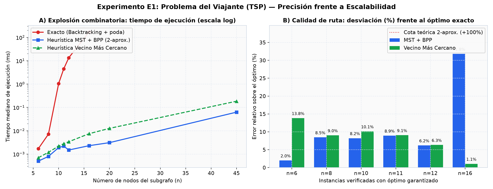
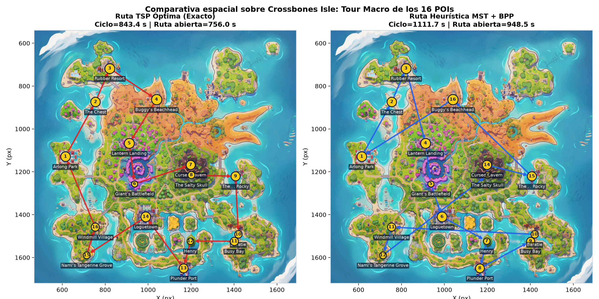
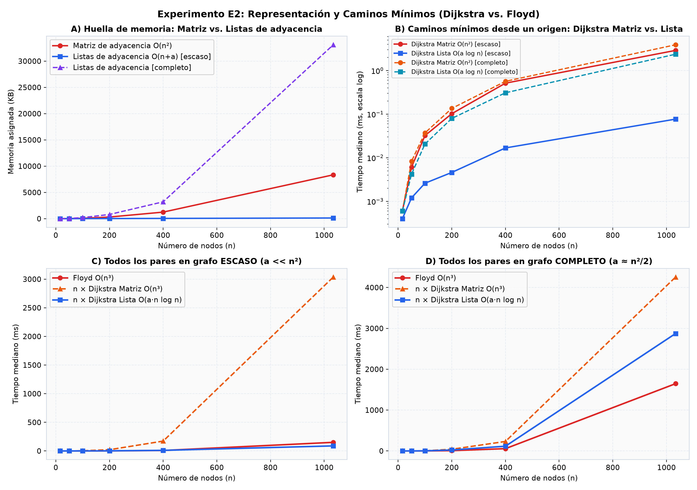
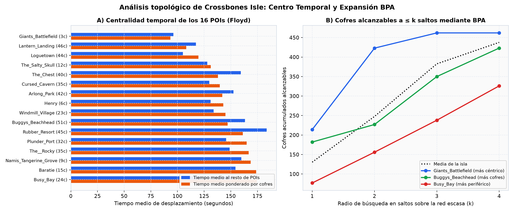
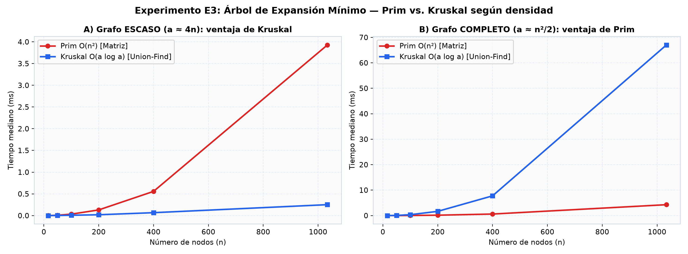
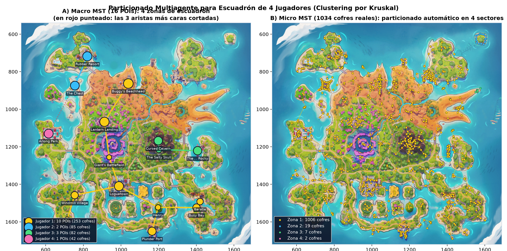
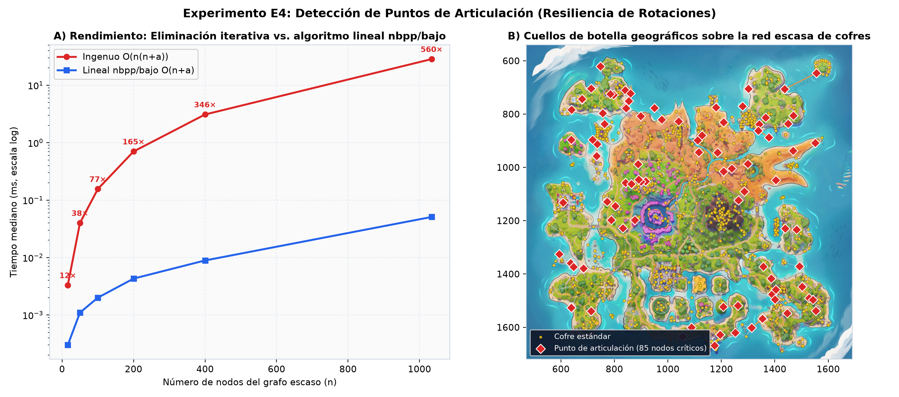
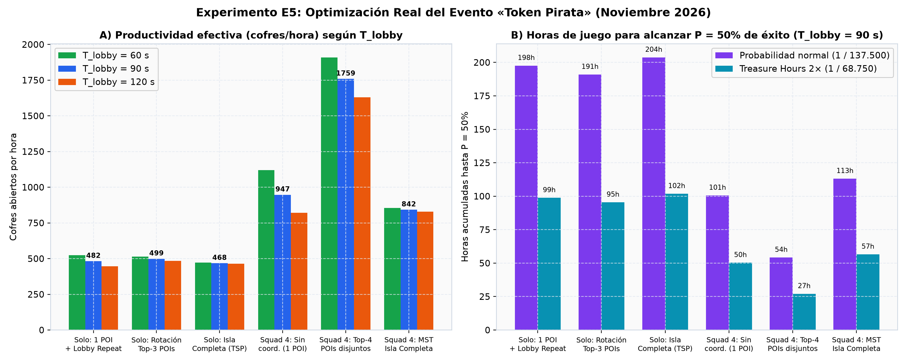

# Optimización de Rutas de Recolección y Particionado Multiagente sobre Grafos Espaciales
## Estudio Algorítmico Aplicado al Evento «Token Pirata» de Fortnite (2026)

**Asignatura:** Algoritmos y Estructuras de Datos I (AED1) — Grado en Ingeniería Informática (UMU)  
**Actividad:** Tema 4 — Grafos (Curso 2026/2027)  
**Autores:** Juan José Cortés Arnaldos y Raúl Sánchez Ayala  
**Repositorio reproducible:** `[https://github.com/jjcortess/token-grafos-aed1]`  

---

## 1. Introducción y Objetivo de la Investigación (T1)

Durante la minitemporada *Cazatesoros (Treasure Hunters)* de Fortnite (noviembre–diciembre de 2026), el desbloqueo del *Pirate Shop Access Token* («Token Pirata») sigue un proceso de ensayos de Bernoulli independientes por cada cofre abierto en el mapa **Crossbones Isle**, con probabilidad constante:

$$p_{\text{base}} = \frac{1}{137\,500} \qquad \text{y} \qquad p_{2\times} = \frac{1}{68\,750} \text{ (durante Treasure Hours)}$$

Dado que no existen cofres con mayor probabilidad individual ni memoria entre intentos, la probabilidad acumulada de obtener al menos un token tras abrir $k$ cofres es $P(\text{éxito}) = 1 - (1 - p)^k$. En términos de **Investigación Operativa y Optimización Combinatoria**, maximizar las opciones reales del jugador o escuadrón equivale estrictamente a **maximizar la tasa de cofres abiertos por hora** sobre un grafo espacial ponderado por tiempos reales de desplazamiento y saqueo.

### Preguntas de investigación
1. **Compromiso exactitud vs. tiempo en problemas NP-completos (TSP):** ¿Hasta qué tamaño $n$ resulta tratable resolver exactamente la ruta óptima de recolección mediante *backtracking* con poda y cuánto se desvían en la práctica las heurísticas polinómicas (MST+BPP y Vecino Más Cercano)?
2. **Impacto empírico de la representación y la densidad del grafo:** ¿Cómo se comportan en tiempo y memoria las matrices frente a las listas de adyacencia en caminos mínimos (Dijkstra $O(n^2)$ vs. $O(a \log n)$, Floyd $O(n^3)$ vs. $n\text{-Dijkstra}$), árboles de expansión mínimos (Prim vs. Kruskal) y detección de puntos de articulación (ingenuo vs. lineal `nbpp`/`bajo`)?
3. **Estrategia aplicada y coordinación multiagente:** Con tiempos reales de desplazamiento, apertura y espera en vestíbulo ($T_{\text{lobby}}$), ¿qué estrategia maximiza la tasa de cofres/hora en solitario (*Loot–Lobby–Repeat* vs. rotación parcial vs. tour completo) y en escuadrón de 4 jugadores (sin coordinación vs. particionado automático por MST vs. asignación de Top-4 POIs disjuntos)?

---

## 2. Datasets Reales y Modelado mediante Grafos (T2 y T3.1)

### 2.1. Fuentes públicas y garantía de reproducibilidad
Para evitar datos sintéticos y garantizar la verificabilidad offline incluso tras la finalización del evento (5 de diciembre de 2026), se han congelado en `data/raw/` con firmas de integridad `SHA-256` dos fuentes públicas de noviembre de 2026:

* **`Fortnite-API (/v1/map)`:** API pública de la que se descargó mediante `01_fetch_snapshot.py` el mapa oficial `map_crossbones_2026_blank.png` ($2048 \times 2048\text{ px}$) y las coordenadas exactas en unidades de Unreal Engine (`100 u = 1 m`) de los 16 puntos de interés (POIs y *landmarks*) de *Crossbones Isle*.
* **`MapSpawns.json` (parche v43.10, 13 de noviembre de 2026, fuente `lifecrisis.life/loot`):** Volcado completo de los puntos de aparición de la isla. Filtrando estrictamente las categorías válidas para el token (`chest`, `buried_chest` y `rare_chest`), se obtuvieron **$N = 1\,034$ cofres individuales reales** georreferenciados sobre la cuadrícula exacta de $2048 \times 2048\text{ px}$.

### 2.2. Calibración física y familia de grafos generados
El script `02_build_graphs.py` empareja los 16 POIs comunes entre ambas fuentes para calibrar automáticamente la escala espacial real (`metros/píxel`) y transforma distancias euclídeas en **pesos en segundos de desplazamiento** ($v_{\text{base}} = 6{,}0\text{ m/s}$, tiempo de apertura $1{,}2\text{ s}$ y $+2{,}0\text{ s}$ extra para cofres enterrados). Se exportaron 19 grafos no dirigidos ponderados en formato plano `.graph` organizados en dos niveles:

| Nivel / Familia | Ficheros `.graph` | Nodos ($n$) | Aristas ($m$) | Uso experimental |
| :--- | :--- | :---: | :---: | :--- |
| **Macro (POIs reales)** | `macro_poi_sparse` / `complete` | 16 | 28 / 120 | Centralidad, BPA, TSP exacto macro, escuadrón de 4 y E5 |
| **Micro TSP (E1)** | `micro_tsp_n{6,8,10,11,12,20,45}_complete` | 6 a 45 | 15 a 990 | Crecimiento exponencial exacto vs. heurísticas |
| **Micro Escalado (E2–E4)** | `micro_scale_n{50,100,200,400}_{sparse,complete}` | 50 a 400 | $k\text{-NN}$ / $n(n-1)/2$ | Curvas de complejidad y cruce matriz vs. listas |
| **Isla Completa (E2–E4)** | `micro_island_sparse` / `complete` | **1\,034** | **2\,648** / **534\,061** | Benchmark máximo de memoria, tiempo y cuellos de botella |

*(Los grafos escasos se construyen uniendo cada nodo a sus $k$ vecinos más cercanos y añadiendo las aristas puente más cortas estrictamente necesarias entre componentes aislados con penalización de terreno $1{,}5\times$, garantizando conexidad para MST y reflejando pasos críticos geográficos.)*

---

## 3. Diseño e Implementación del Núcleo Algorítmico en C++17 (T3.2)

Todo el núcleo algorítmico está escrito en **C++17 estándar sin dependencias externas**, compilado con `g++ -std=c++17 -O2 -Wall -Wextra`, y organizado modularmente en `src/cpp/` siguiendo de forma estricta los algoritmos del Tema 4 de la asignatura:

* **`graph.{hpp,cpp}` (Tema 4.2):** Implementa simultáneamente `GrafoMatriz` (matriz plana contigua de $n \times n$ `double`, memoria $O(n^2)$) y `GrafoLista` (listas de adyacencia con vectores, memoria $O(n+a)$), exponiendo su consumo real de memoria en bytes.
* **`traversals.{hpp,cpp}` (Tema 4.3.1):** Búsqueda Primero en Profundidad (`bpp`) con vector de padres y detección de ciclos/componentes conexos (admitiendo la exclusión de un nodo para análisis de fallos), y Búsqueda Primero en Anchura (`bpa`) con cola para calcular cofres alcanzables a $\le k$ saltos.
* **`mst.{hpp,cpp}` (Tema 4.3.2):** Algoritmo de **Prim** con arrays `mas_cercano` y `menor_coste` sobre `GrafoMatriz` ($O(n^2)$), algoritmo de **Kruskal** con ordenación de aristas y estructura de relación de equivalencia `RelacionEquivalencia` con punteros al padre (`encuentra`/`unir` con compresión de caminos y unión por rango, $O(a \log a)$), y particionado en 4 escuadrones eliminando las 3 aristas de mayor coste del MST.
* **`shortest_paths.{hpp,cpp}` (Tema 4.3.3):** **Dijkstra clásico** sobre matriz con búsqueda lineal del mínimo ($O(n^2)$), **Dijkstra optimizado** sobre listas con cola de prioridad (`std::priority_queue`, $O(a \log n)$), y **Floyd** ($O(n^3)$) con matrices $D$ y $P$ y reconstrucción recursiva `reconstruir_camino_floyd`.
* **`articulation.{hpp,cpp}` (Tema 4.3.5.1):** Comparativa directa entre el **algoritmo ingenuo** (eliminar cada nodo y lanzar BPP, $O(n(n+a))$) y el **algoritmo lineal** en una sola BPP manteniendo `nbpp[v]` y `bajo[v]` ($O(n+a)$).
* **`tsp.{hpp,cpp}` (Tema 4.3.6):** **TSP exacto** mediante *backtracking* con poda admisible por aristas mínimas salientes y ruptura de simetría, frente a dos heurísticas polinómicas: **MST + BPP en preorden** (2-aproximación métrica) y **Vecino Más Cercano** multi-inicio.
* **`experiments.{hpp,cpp}` y `main.cpp`:** Automatiza los 5 experimentos (E1–E5), mide tiempos con `std::chrono::steady_clock` tomando la **mediana** sobre múltiples repeticiones para filtrar ruido del sistema operativo, y ejecuta **verificación cruzada automática** entre algoritmos equivalentes.

---

## 4. Resultados Experimentales y Análisis Técnico (T3.3 y T4)

Todas las ejecuciones verificaron el **100 % de consistencia cruzada**: las distancias mínimas de Dijkstra Matriz, Dijkstra Lista y Floyd coincidieron exactamente en todos los grafos; Prim y Kruskal produjeron idéntico coste de MST; y los algoritmos ingenuo y lineal detectaron exactamente los mismos puntos de articulación.

### 4.1. Experimento E1: Problema del Viajante (TSP) — Exactitud frente a Escalabilidad

* **Explosión combinatoria controlada por poda:** Gracias a la cota inicial de Vecino Más Cercano, la poda por aristas mínimas salientes y la ruptura de simetría, el algoritmo exacto logró certificar el óptimo global hasta el grafo macro completo (`macro_poi_complete`, $n = 16$) en **$172{,}964\text{ ms}$** tras explorar **$2\,217\,107$ estados**. Para instancias mayores ($n = 20, 45$), el espacio factorial vuelve intratable el cálculo exacto en tiempo interactivo.
* **Calidad práctica de las heurísticas:** Frente a la cota teórica del $+100\%$ de error garantizada por la 2-aproximación métrica, **MST + BPP** obtuvo un error medio de tan solo el **$10{,}94\%$** (máximo $31{,}82\%$), mientras que **Vecino Más Cercano multi-inicio** alcanzó un error medio del **$8{,}24\%$** (máximo $13{,}84\%$), ejecutándose ambos en fracciones de milisegundo incluso para $n = 45$. Esto confirma en un mapa real las conclusiones del Tema 4.3.6 sobre el equilibrio entre optimalidad y coste computacional en problemas NP-completos.

### 4.2. Experimento E2: Representación, Caminos Mínimos, Centralidad y BPA

| Grafo ($n = 1\,034$) | Aristas ($m$) | Memoria Matriz | Memoria Listas | $n\times\text{Dijkstra}$ Lista | $n\times\text{Dijkstra}$ Matriz | Floyd $O(n^3)$ |
| :--- | :---: | :---: | :---: | :---: | :---: | :---: |
| **Isla Escasa** ($a \ll n^2$) | 2\,648 | $8\,352{,}8\text{ KB}$ | **$130{,}6\text{ KB}$** ($-98{,}4\%$) | **$88{,}22\text{ ms}$** | Mayor que lista | $150{,}27\text{ ms}$ |
| **Isla Completa** ($a \approx n^2/2$) | 534\,061 | $8\,352{,}8\text{ KB}$ | $> 8\,352\text{ KB}$ | $2\,874{,}28\text{ ms}$ | $4\,256{,}62\text{ ms}$ | **$1\,646{,}86\text{ ms}$** |

* **Validación exacta de la teoría (Tema 4.2 y 4.3.3):** En el grafo escaso de $1\,034$ cofres, las listas de adyacencia reducen el uso de memoria en un **98,4 %** y $n \times \text{Dijkstra}$ con cola de prioridad ($O(a \cdot n \log n)$) es **1,70× más rápido** que Floyd ($88{,}22\text{ ms}$ vs. $150{,}27\text{ ms}$). Sin embargo, en el grafo completo de $534\,061$ aristas se invierte el ganador: **Floyd ($1\,646{,}86\text{ ms}$)** supera en **1,75×** a $n \times \text{Dijkstra}$ con listas ($2\,874{,}28\text{ ms}$) y en **2,58×** a $n \times \text{Dijkstra}$ con matriz ($4\,256{,}62\text{ ms}$), debido al coste logarítmico de las operaciones de montículo sobre medio millón de aristas frente al bucle triple contiguo en caché de Floyd. *(Nótese que Floyd también corre más rápido en el grafo escaso porque el atajo `if (!isfinite(d_ik)) continue` omite iteraciones sin camino en las primeras fases $k$.)*

* **Centro temporal de *Crossbones Isle*:** Según la matriz de caminos mínimos de Floyd ponderada por el número de cofres de cada destino, el punto más estratégico para aterrizar y rotar hacia cualquier sector es **`Giant's Battlefield`** ($93{,}4\text{ s}$ de desplazamiento medio), mientras que el extremo más aislado es **`Busy Bay`** ($174{,}5\text{ s}$). El análisis BPA en $k = 1 \dots 4$ saltos confirma que aterrizar cerca del centro multiplica el volumen de cofres accesibles en los primeros 2 saltos.

### 4.3. Experimento E3: Prim vs. Kruskal y Particionado en 4 Escuadrones

| Grafo ($n = 1\,034$) | Aristas ($m$) | Prim $O(n^2)$ | Kruskal $O(a \log a)$ | Ganador y aceleración | Coste MST |
| :--- | :---: | :---: | :---: | :---: | :---: |
| **Isla Escasa** | 2\,648 | $3{,}928\text{ ms}$ | **$0{,}251\text{ ms}$** | **Kruskal (15,6× más rápido)** | $4\,169{,}9\text{ s}$ |
| **Isla Completa** | 534\,061 | **$4{,}274\text{ ms}$** | $67{,}015\text{ ms}$ | **Prim (15,7× más rápido)** | $4\,037{,}6\text{ s}$ |

* **Cruce simétrico según densidad:** Este resultado constituye una demostración experimental idónea del Tema 4.3.2. El tiempo de Prim depende casi exclusivamente de $n^2$ ($3{,}93\text{ ms}$ en escaso vs. $4{,}27\text{ ms}$ en completo), mientras que Kruskal escala con la ordenación de las $m$ aristas ($O(a \log a)$): domina por **15,6×** cuando $a \ll n^2$, pero se penaliza en **15,7×** al ordenar $534\,061$ aristas en el grafo completo.

* **Análisis crítico del particionado MST (efecto cadena):** Al eliminar las 3 aristas más caras del MST macro (`macro_poi_complete`) para dividir la isla entre 4 jugadores, el reparto resultante fue muy asimétrico: **J1: 10 POIs (253 cofres)**, **J2: 2 POIs (85 cofres)**, **J3: 3 POIs (82 cofres)** y **J4: 1 POI (42 cofres)**. Esto pone de manifiesto una limitación bien conocida del *clustering* por enlace único (*single-linkage*): las aristas más largas suelen aislar ubicaciones periféricas en clústeres de un solo nodo en lugar de equilibrar el núcleo central. Como se comprueba en E5, ese desequilibrio convierte al Jugador 1 en un cuello de botella temporal para todo el equipo.

### 4.4. Experimento E4: Puntos de Articulación (Resiliencia de Rotaciones)

* **Salto asintótico confirmado:** Sobre `micro_island_sparse` ($n=1\,034, m=2\,648$), el algoritmo ingenuo ($O(n(n+a))$) tardó **$28{,}540\text{ ms}$**, mientras que el algoritmo lineal de una única BPP con vectores `nbpp` y `bajo` ($O(n+a)$) resolvió exactamente los mismos **85 puntos de articulación** en **$0{,}0509\text{ ms}$**, alcanzando una aceleración de **560,2×**.
* **Interpretación táctica:** Los 85 nodos críticos identificados sobre el mapa corresponden principalmente a los extremos de los puentes inter-zona y pasos estrechos entre agrupaciones de cofres. En partida real, si un escuadrón rival controla uno de estos nodos, desconecta el grafo de rotación local y obliga a realizar rodeos costosos o reiniciar la partida.

### 4.5. Experimento E5: Estrategia Óptima para el Token Pirata ($T_{\text{lobby}} = 90\text{ s}$)

| Estrategia | Jugadores | Cofres/hora | Horas $P=50\%$ (Normal) | Horas $P=50\%$ ($2\times$) | Horas $P=90\%$ ($2\times$) |
| :--- | :---: | :---: | :---: | :---: | :---: |
| **`Squad4_Top4_POIs_Repeat`** | 4 | **1\,758,9** | **54,2 h** | **27,1 h** | **90,0 h** |
| `Squad4_Sin_Coordinacion_1POI` | 4 | 947,3 | 100,6 h | 50,3 h | 167,1 h |
| `Squad4_Particionado_MST_Isla` | 4 | 842,5 | 113,1 h | 56,6 h | 187,9 h |
| **`Solo_Rotacion_Top3_POIs`** | 1 | **499,1** | **191,0 h** | **95,5 h** | **317,2 h** |
| `Solo_Loot_Lobby_Repeat_1POI` | 1 | 482,3 | 197,6 h | 98,8 h | 328,2 h |
| `Solo_Rotacion_Completa_TSP` | 1 | 467,8 | 203,7 h | 101,9 h | 338,4 h |

* **En solitario:** Con un tiempo estándar de reinicio $T_{\text{lobby}} = 90\text{ s}$, la mejor estrategia no es reiniciar tras un único POI ni limpiar toda la isla, sino **encadenar una rotación corta de los 3 POIs más densos mediante los caminos mínimos de Floyd** ($499{,}1\text{ cofres/h}$, un $+3{,}5\%$ sobre *Loot–Lobby–Repeat* y $+6{,}7\%$ sobre el tour TSP completo). Amortiza el tiempo muerto de carga sin pagar los largos desplazamientos hacia la periferia.
* **En escuadrón de 4 jugadores:** Coordinarse para que cada jugador caiga en uno de los **Top-4 POIs disjuntos** y reiniciar dispara el rendimiento hasta **$1\,758{,}9\text{ cofres/h}$** (**3,52×** más rápido que el mejor jugador en solitario y **1,86×** más rápido que 4 jugadores cayendo juntos en el mismo POI). En *Treasure Hours* ($2\times$), reduce el tiempo mediano para conseguir el token ($P=50\%$) de **95,5 h** en solitario a **27,1 h** en escuadrón coordinado.
* **Lección algorítmica del MST en E5:** El particionado MST clásico de toda la isla cae a $842{,}5\text{ cofres/h}$ porque los jugadores 2, 3 y 4 terminan muy pronto mientras esperan al Jugador 1 (253 cofres). Esto demuestra que, para asignación de tareas multiagente, un algoritmo puramente geométrico (corte de MST) debe complementarse con restricciones de **balanceo de carga** (*balanced graph partitioning*), abriendo una línea clara de trabajo futuro.

---

## 5. Conclusiones

1. **Validación rigurosa de la teoría de AED1:** Los experimentos sobre datos reales de $1\,034$ nodos reproducen fielmente las predicciones asintóticas del Tema 4: ahorro del $98{,}4\%$ de memoria con listas en grafos escasos, cruce simétrico de $\sim 15{,}6\times$ entre Prim y Kruskal según densidad, ventaja de $n\times\text{Dijkstra}$ en redes escasas frente a Floyd en redes completas, y aceleración de $560{,}2\times$ en puntos de articulación con `nbpp`/`bajo`.
2. **Utilidad práctica de las heurísticas en problemas NP-completos:** En el grafo espacial real, las heurísticas MST+BPP ($10{,}94\%$ de error medio) y Vecino Más Cercano ($8{,}24\%$) ofrecen soluciones prácticamente inmediatas y muy cercanas al óptimo exacto, evitando la barrera exponencial del TSP.
3. **Valor del análisis crítico:** El experimento E5 demostró que la elección de la técnica algorítmica debe ajustarse a las restricciones del dominio (tiempos muertos de vestíbulo y balanceo entre agentes): coordinar 4 jugadores en los 4 POIs más densos supera en más del doble al particionado MST desbalanceado.

---

## 6. Reparto de Tareas entre los Integrantes (T5)

El trabajo se desarrolló de forma colaborativa mediante control de versiones (Git/GitHub), dividiendo responsabilidades técnicas para que ambos integrantes participasen tanto en el núcleo C++ como en el análisis y la redacción:

| Fase / Módulo | Responsable principal | Revisión y pruebas | Aportación concreta |
| :--- | :--- | :--- | :--- |
| **T1–T2: Definición y búsqueda de datasets** | Ambos integrantes | Ambos integrantes | Definición matemática del evento Token Pirata, localización de `Fortnite-API` y `MapSpawns.json` (v43.10), validación con el profesor. |
| **T3.1: Preprocesamiento Python** (`01_fetch_snapshot.py`, `02_build_graphs.py`) | Juanjo | Raúl | Congelación del snapshot con SHA-256, calibración `m/px`, generación de los 19 `.graph` y mapas de previsualización. |
| **T3.2 (Bloque A): C++17** (`graph`, `traversals`, `mst`, `articulation`) | Juanjo | Raúl | Implementación de `GrafoMatriz`, `GrafoLista`, BPP, BPA, Prim, Kruskal (`RelacionEquivalencia`) y Puntos de Articulación (ingenuo y `nbpp`/`bajo`). |
| **T3.2 (Bloque B): C++17** (`shortest_paths`, `tsp`, `experiments`, `main`) | Raúl | Juanjo | Implementación de Dijkstra (matriz y listas), Floyd (matrices $D$ y $P$), TSP (exacto con poda y heurísticas), batería E1–E5 y verificación cruzada. |
| **T3.3 y T4: Visualización y Análisis** (`03_analyze_plots.py`) | Raúl | Juanjo | Generación de las 8 figuras de alta resolución, análisis de resultados y redacción de conclusiones técnicas. |
| **T5: Memoria PDF y Repositorio GitHub** | Ambos integrantes | Ambos integrantes | Redacción conjunta de la memoria, `README.md`, pruebas limpias de reproducibilidad (`make run`) y preparación de defensa oral. |

---

## 7. Documentación Transparente del Uso de IA Generativa (T5)

De acuerdo con las directrices de la actividad, se ha utilizado un asistente de IA generativa (Google Gemini) como herramienta de apoyo y tutorización técnica a lo largo de las cinco fases del proyecto. A continuación se detalla explícitamente qué aportó la IA y qué decisiones, verificaciones y trabajo corresponden a los autores:

* **Ideación y refinamiento del dataset (T1–T2):** La IA ayudó a estructurar el planteamiento probabilístico y las 5 hipótesis experimentales (E1–E5). Inicialmente propuso usar un dataset histórico de Kaggle de cofres de Fortnite, que **descartamos por criterio propio** al comprobar que tenía 9 años de antigüedad y no reflejaba el mapa de 2026; localizamos y aportamos manualmente el volcado real `MapSpawns.json` (parche v43.10, noviembre de 2026), despues de un largo proceso de busqueda que parecia no llegar a nada. Tras lo cual, le pedimos a la IA adaptar el pipeline de preprocesamiento a ese formato exacto.
* **Asistencia en programación Python y C++ (T3.1–T3.3):** La IA generó borradores estructurados de los scripts de preprocesamiento (`01_fetch_snapshot.py`, `02_build_graphs.py`), de los módulos C++17 ajustados estrictamente a los apuntes de `tema4.pptx` y del script de gráficas (`03_analyze_plots.py`).
* **Verificación, ejecución y comprensión por nosotros (T4–T5):** Ejecutamos localmente toda la cadena de datos, compilamos y probamos el binario en C++, inspeccionaron los grafos generados sobre el mapa real (`preview_01`–`03`) para comprobar que no hubiera desplazamientos ni datos sintéticos, verificamos el **100 % PASS** en todas las comprobaciones cruzadas de algoritmos y revisamos línea por línea cada estructura y algoritmo de C++ para asegurar comprensión total del código y del significado de los hallazgos (como el efecto cadena en el particionado MST). La redacción final de la memoria fue estructurada con apoyo de la IA a partir de los resultados reales de `results/analysis_summary.md` y revisada íntegramente por ambos integrantes.